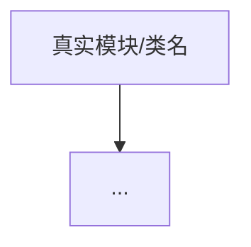
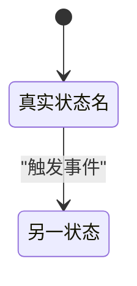
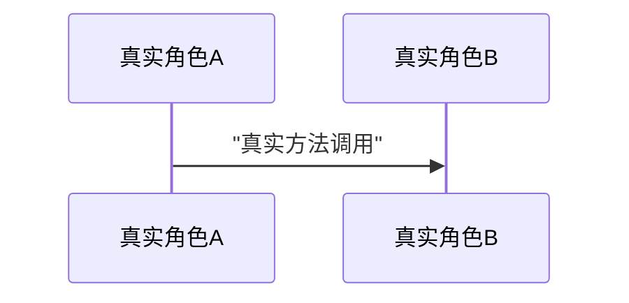

# 文档骨架模板（章节积木池 + 写法说明）

本文件是**空骨架 + 每节写法说明**，不含任何范例内容。
研读时按对象类型从下方"章节池"中挑选组装，填充时删除所有 `<写法说明：...>` 注释。

## 按研读对象类型选用章节

| 章节 | SUBSYSTEM | FEATURE | CONCEPT |
|---|---|---|---|
| 一、这是什么 & 为什么需要 | 必 | 必 | 必 |
| 二、整体全景图 | 必 | 必 | 选 |
| 三、核心设计 | 必 | 选 | 选 |
| 四、实现原理：关键文件逐个讲 | 必 | 必 | 必 |
| 五、数据结构 | 必 | 选 | 选 |
| 六、状态转移 | 按需 | 按需 | 极少 |
| 七、完整数据流全景图 | 必 | 必 | 选 |
| 八、关键保证 & 边界 | 必 | 选 | 选 |
| 九、动手实验 | 必 | 选 | 选 |
| 十、下一篇预告 | 选 | 选 | 选 |
| （附）通用原理 vs 本项目用法 | — | — | CONCEPT 专用，建议放在第一节后 |

**铁律不随类型变**：基础认知（第一节）、实现原理（第四节）、以及"充分读全代码再写"的纪律，三种类型都强制保留。

---

# 以下为骨架正文（复制后填充，删除所有 `<写法说明>`）

---

# NN - {研读对象名}：{一句话定位}

> <写法说明：一句话引入。说明这个对象在整体中的位置、本篇要解决什么疑问。若是系列文档，可衔接上一篇。>

## 一、这是什么 & 为什么需要

<写法说明：
- 先下一个清晰定义（一句话说清它是什么）。
- 再讲"不用它会有什么痛点 / 它解决了什么问题"。
- 最后给一个行业通用的心智模型或生活化类比，降低认知门槛。
- 禁止开篇直接贴代码。>

## （附，仅 CONCEPT 类）通用原理 vs 本项目用法

<写法说明：仅知识点提问时使用。
- 上半部分：讲清这个概念/技术的行业通用原理（可引用通用知识）。
- 下半部分：落到"本项目里是怎么用 / 怎么实现的"——这部分必须有源码支撑。
- 用对比明确区分"通用"和"本项目特有"。>

## 二、整体全景图

<写法说明：
- 图在前、文字在后，让人 30 秒看懂整体结构与主流程。
- 优先用 Mermaid：模块组成与依赖用 `flowchart TD/LR` + `subgraph` 分层。
- 图下方必须有一段文字解读。>



<图解读：用一段话说明这张图在表达什么。>

## 三、核心设计

<写法说明：用表格列出 2-4 个核心设计点。每行：设计点 / 目的 / 在代码里如何实现。>

| 设计 | 目的 | 实现方式（对应类/机制） |
|---|---|---|
|  |  |  |

## 四、实现原理：关键文件逐个讲

<写法说明：本篇的核心。对每个关键类/方法：
- 贴真实源码片段（精简到关键部分），并在片段前后标注来源 `文件路径:行号`。
- 解释它做什么、为什么这么写。
- 必要时配类比（如用 @RequestMapping 类比 @Tool）。
- 接口要连着讲它的实现类，不能只讲接口。>

### 4.1 {类/方法名}（`文件路径:行号`）

```java
// 真实源码片段
```

<解释：这段代码做什么、关键点在哪。>

### 4.2 {类/方法名}（`文件路径:行号`）

```java
// 真实源码片段
```

<解释：...>

## 五、数据结构

<写法说明：
- 列出核心数据对象（BO/Entity/DTO/枚举）的字段清单，逐字段说明含义。
- 数据对象间有关系时，可用 Mermaid classDiagram / erDiagram 画。
- 字段含义必须来自真实代码，不靠字段名猜测。>

| 字段 | 类型 | 含义 |
|---|---|---|
|  |  |  |


## 六、状态转移

<写法说明：仅当该对象有状态机时写，否则整节删除并在大纲中注明"无状态，跳过"。
- 用 Mermaid `stateDiagram-v2` 画状态转移图。
- 状态名、转移触发事件必须来自真实代码（如状态枚举、事件定义）。
- 图后用表格或列表说明"什么事件触发什么转移"。>



<转移规则说明：...>

## 七、完整数据流全景图

<写法说明：
- 端到端展示一次完整调用，从入口到出口，标注每一步。
- 多角色时间交互优先用 Mermaid `sequenceDiagram`；
  需要贴着代码逐步走、内联标注细节时，用 ASCII 图（等宽表达力更强）。
- 步骤必须与真实调用链一致。>



<或在需要代码级细节时改用 ASCII 调用链图。>

## 八、关键保证 & 边界

<写法说明：
- 这个设计保证了什么（如幂等、并发安全、可恢复等），分别靠什么机制实现。
- 边界与现状：什么还没实现 / 未接通 / 是预留骨架，诚实标注（铁律 4）。>

## 九、动手实验

<写法说明：2-3 个可操作的练习，由易到难，最好能跑起来验证。CONCEPT 类可选。>

1.
2.
3.

## 十、下一篇预告

<写法说明：一句话引到下一个值得研读的对象。系列文档时使用。>
